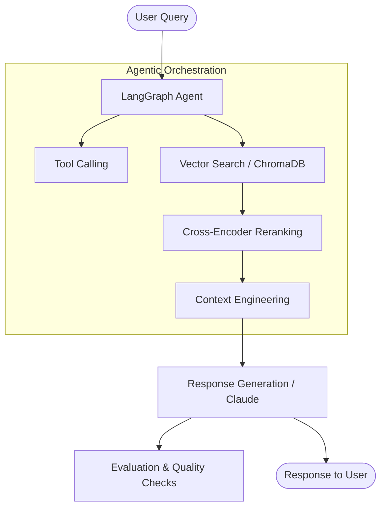

# SecureRAG - Cybersecurity Q&A Agent with LangGraph

[](https://www.python.org/downloads/)
[](https://github.com/langchain-ai/langgraph)
[](LICENSE)

> **Status**: 🚧 Under Active Development

## Overview

**SecureRAG** is an agentic Retrieval-Augmented Generation (RAG) system engineered for cybersecurity question answering over Common Vulnerabilities and Exposures (CVE) advisories and MITRE ATT&CK framework knowledge bases. 

Powered by **LangGraph**, SecureRAG coordinates multi-step agent orchestration featuring tool-calling, semantic vector search, context engineering, chunking strategies, embedding comparison, hybrid search, and cross-encoder reranking to ensure precise, grounded, and actionable security intelligence.

---

## Architecture



---

## Project Structure

```text
SecureRAG/
├── data/
│   ├── raw/                      # Raw CVE JSON & MITRE data
│   └── vectorstore/              # Persistent ChromaDB collections
├── evals/
│   ├── __init__.py
│   └── evaluate.py               # Evaluation harness and metrics
├── notebooks/                     # Exploratory analysis & experiments
├── scripts/
│   └── fetch_cve.py              # Automated NVD API ingestion
├── src/
│   ├── __init__.py
│   ├── agent.py                  # LangGraph agent definition & workflows
│   ├── config.py                 # Central pipeline configuration
│   ├── ingest.py                 # Text chunking and vectorstore ingestion
│   └── retriever.py              # Hybrid retrieval & reranker
├── tests/
│   ├── __init__.py
│   └── test_config.py            # Unit tests
├── ui/
│   └── app.py                    # Streamlit interactive web interface
├── .gitignore
├── LICENSE
├── README.md
└── requirements.txt
```

---

## Quick Start

### 1. Prerequisites
- Python 3.10 or higher
- Anthropic API key (set in your environment)

### 2. Installation
Clone the repository and install dependencies:
```bash
git clone https://github.com/your-username/SecureRAG.git
cd SecureRAG
python -m venv .venv
# On Windows:
.venv\Scripts\activate
# On Linux/macOS:
# source .venv/bin/activate

pip install -r requirements.txt
```

### 3. Environment Setup
Create a `.env` file in the root directory:
```env
ANTHROPIC_API_KEY=your_anthropic_api_key_here
```

### 4. Fetch Advisories & Ingest
```bash
# Fetch recent CVEs
python scripts/fetch_cve.py

# Ingest data into ChromaDB (once implemented)
python -m src.ingest
```

### 5. Launch UI
```bash
streamlit run ui/app.py
```

---

## Evaluation Results

| Metric | Value |
| :--- | :--- |
| **Accuracy** | TBD |
| **Hallucination Rate** | TBD |
| **P95 Latency** | TBD |
| **Retrieval Precision** | TBD |

---

## Tech Stack

- **Agent Framework**: [LangGraph](https://github.com/langchain-ai/langgraph), [LangChain](https://github.com/langchain-ai/langchain)
- **LLM**: Claude 3.5 Sonnet (`claude-sonnet-4-20250514` / Anthropic API)
- **Vector Database**: [ChromaDB](https://www.trychroma.com/)
- **Embeddings & Reranking**: [Sentence-Transformers](https://www.sbert.net/) (`all-MiniLM-L6-v2`)
- **User Interface**: [Streamlit](https://streamlit.io/)
- **Data Ingestion & APIs**: HTTPX, NVD CVE 2.0 API

---

## License

This project is licensed under the MIT License - see the [LICENSE](LICENSE) file for details.
